# HippoCoMM.V1
A 3D neuroinspired computational model of the hippocampus CA1 subfield

Tutorial for the HippoComm Software.

# Generalities

When you open the software, it will look like this:

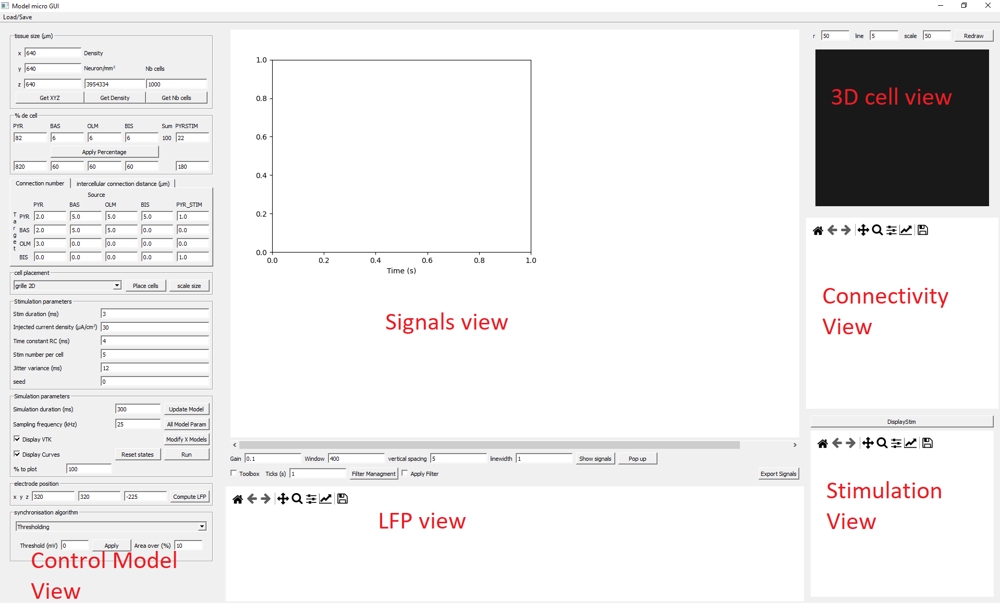

It has various different views that will be explained later.

# Control panel
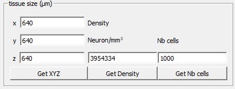

This part is used to set the desired tissue dimensions.

The user must enter at least two columns.

  will compute the x, y and z from neuron density and the number of cell.

  will compute the neuron density from x, y, and z and the number of cell.

  will compute the number of cell from x, y, and z and the neuron density.

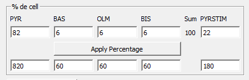This part determines the distribution of neurons among the different types (PYR, BAS, OLM, and BIS).

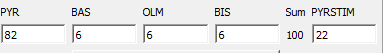 The top part is expressed as a percentage. The sum of the four numbers on the left must be 100; otherwise, the Sum column will turn red

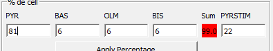 to show the user that a value needs to be updated.

Notice that PYRSTIM, which are PYR cells from CA3 that project onto PYR cells from CA1, are expressed as a percentage of the total number of PYR cells.

 This will compute the number of cells in each group, which is shown in the bottom line:

 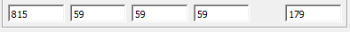

# Interconnection between neurons

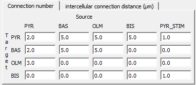

Here we set the interconnection between each type of neurons.

If the number N (integer) is >=1, this means that the source will project onto N neurons

If the number N (float) is 0<N<1, this means that only a fraction of the neurons will project onto one neuron. For instance:  
If N = 0.5, this means that only 1 neuron out of 2 will project onto 1 neuron.  
If N = 0.2, this means that only 1 neuron out of 5 will project onto 1 neuron.

# Intercellular typical distance

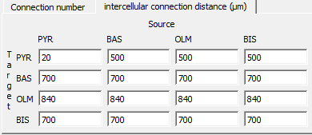

Here is a typical distance between neuron types. It is based on the literature. This table is used when connections are randomly chosen while still taking the distance between cells into account.

# Cell Placement

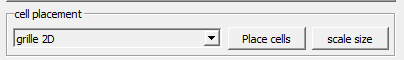

Here, the user can select different way to place the neuron on the 3D environment.

 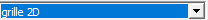cells are place on a 2D plan grid (x,y) equally spaced

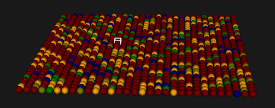

 cells are placed on a 2D plan grid (x,y) with equal spacing, but the PYR cell from CA3 are isolated.

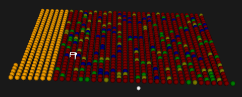

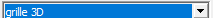 Cells are placed on a 3D grid (x, y, z) with equal spacing.

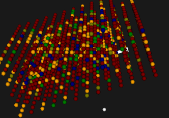

 Cells are placed on a 3D grid (x, y, z) with equal spacing, but the PYR cells from CA3 are isolated.

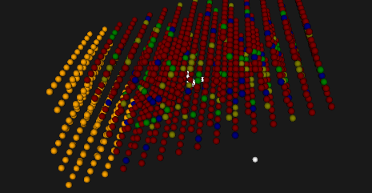

 Cells are placed randomly on a 2D plane (x, y).

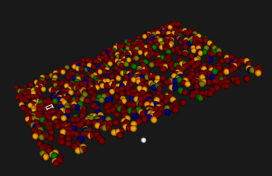

 Cells are placed on a 2D grid (x, y), but the PYR cells from CA3 are isolated.  

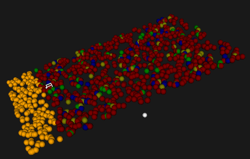

 Cells are placed randomly on a 3D plane (x, y, z).

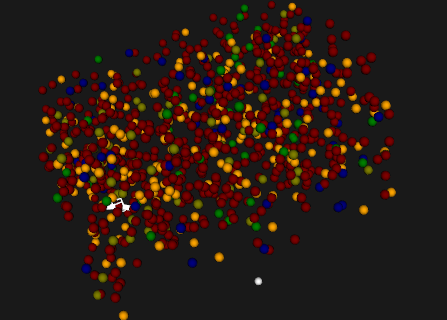

 Cells are placed randomly on a 3D plane (x, y, z), but the PYR cells from CA3 are isolated. 

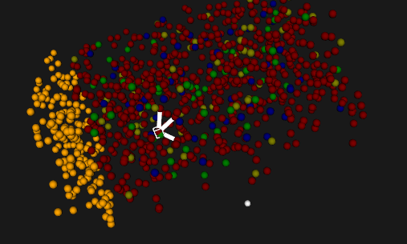

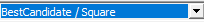 Cells are placed randomly on a 2D plane (x, y). This is the Best Candidate algorithm.

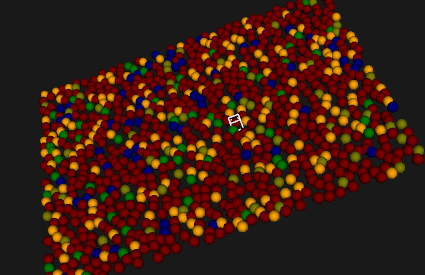

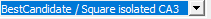 Cells are placed randomly on a 2D plane (x, y). This is the Best Candidate algorithm, but the PYR cells from CA3 are isolated.

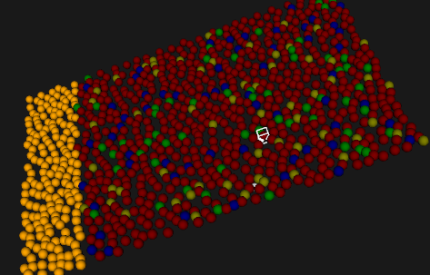

 Cells are placed randomly on a 3D plane (x, y, z). This is the Best Candidate algorithm. 

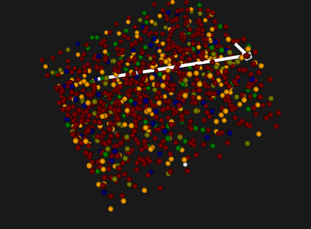

 Cells are placed randomly on a 3D plane (x, y, z). This is the Best Candidate algorithm, but the PYR cells from CA3 are isolated. 

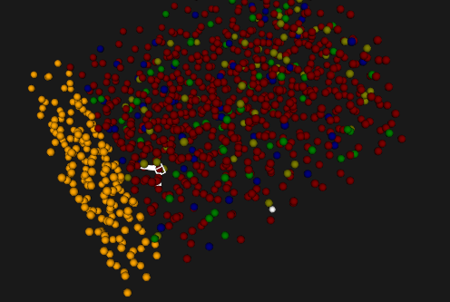

Notice that each time the user places cells in the 3D view, the connections between neurons are reinitialized. This means that you change the position of the cells in space as well as the interconnections between them.

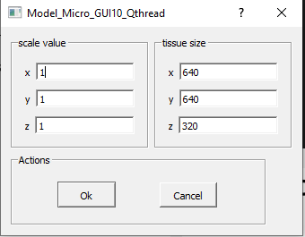

This allows you to change the scale of the tissue without replacing the cells or their interconnections.

# Stimulation Parameters

Each stimulation is a pulse apply onto a PYR cell from CA3.

Here the user can tuned the different parameters for the stimulation.

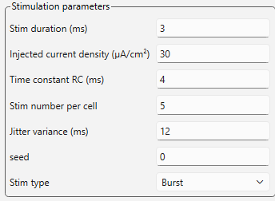

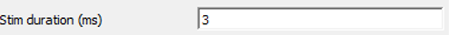 pulse duration 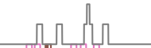

.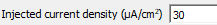 Pulse amplitude

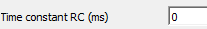Time constant used to smooth the pulse

0: 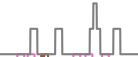  5: 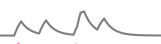

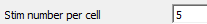 how much pulse will be applied

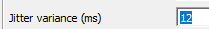 Variance from the center at which to place the pulses:

5: 

20 : 

50 :

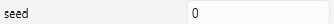The seed is used to force exactly the same noise to be added to the simulation if the number is different from 0. If the number is 0, the simulations will be different for each run.

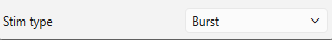 There are two types of stimulation: ‘Burst’, when the stimulation is centered in the middle of the stimulation duration, and ‘Continuous’, which generates continuous stimulation throughout the entire stimulation duration.

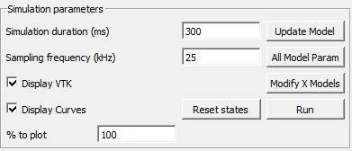

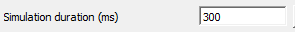 duration of each simulation

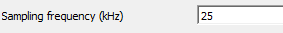 sampling rate

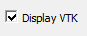 Display or hide the VTK 3D environment if it is not necessary.

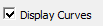 Display or hide the temporal signal view if it is not necessary.

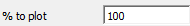 If the number of temporal signals to plot is too large, only the specified percentage of signals will be plotted.

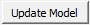 Create the cortical model according to the cell placement. Be careful: each time the cell placement is changed, the cortical model must be recreated (not necessary if you have used the 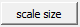 button)

# Update Model’s Parameters

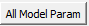 This will display an interface where all parameters can be tuned. 

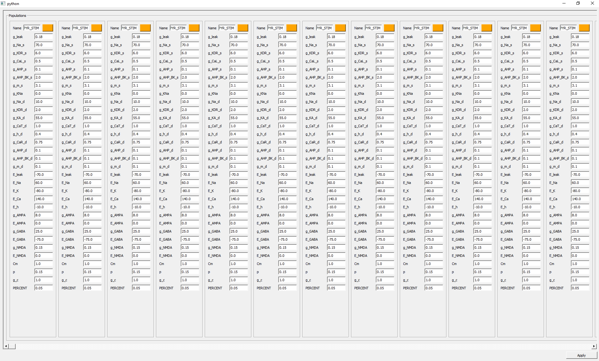

Every parameter of each cell is available, but it can be tedious to use.

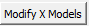 This allows you to modify a group of cells at once.

An interface will appear:

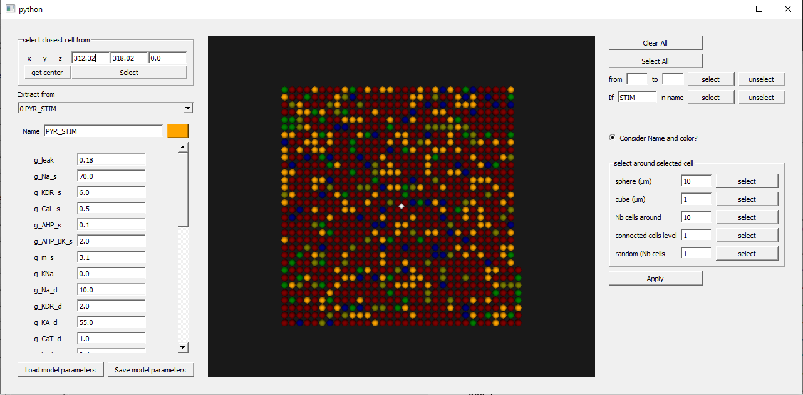

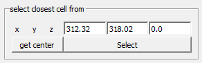 The user can select the nearest cell from a given position.

 The user can select a cell by its ID.

 The user can select a cell directly by clicking on the 3D view.

 Once selected, the parameters of the selected cell will appear in the left list.

The user may change the values displayed here and apply them to all selected cells (this will be explained later when selecting targeted cells).

 This will save the current parameters to a file (parameters from the list).

 This will load a previously saved file (it must correspond to the type of the selected cell).

To select other cells, use the rightmost panel. Notice that only cells of the same type as the selected cell (on the left) can be selected. Selected cells will have a white box around them to make them distinguishable.

 Unselect all cells.

 Select all cells of the same type as the currently selected cell.

 Select or unselect cells from ID to ID.

 Select or unselect cells with a string in their name.

Pressing the CTRL key allows you to select or unselect cells manually when clicked on them.

 This also updates the name and color of the selected cells.

 This allows the user to select a group of cells automatically.

 Select cells that are closer than the specified distance:

 Select cells that are within a cube of the specified width:

 Select n cells around the selected cell.

 if 1 select neighbor cell (cell that receive projection from selected cell) if 2 select neighbor of neighbor. if 3, select neighbor of neighbor of neighbor….

 Select n cells randomly.

 This will apply the current variable list in the left panel to the selected cells.

# Launch the simuation

 This will reset all variable states of the model to zero.

 Run the simulation. A window will be displayed. 

Once the simulation has finished, the results will be plotted in the center of the software.

# Compute the LFP

set the coordinate for the electrode.

 Compute the LFP.

The LFP can be computed with two types of theories. The CSD and the Dipole

The electrode can be selected as three diferent shape

Point: 

Disk:

Cylinder:

 This is used to control the radius the tilts (for the disk and cylinder) and the height (for the cylinder)

Additionally, a butterworth filter can be processed on the LFP the active button here is checked:

